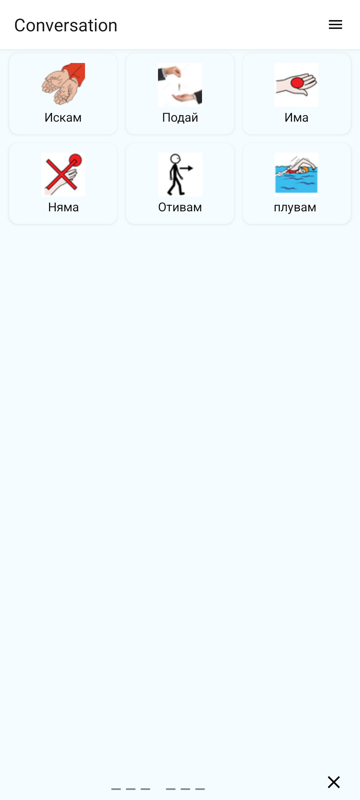
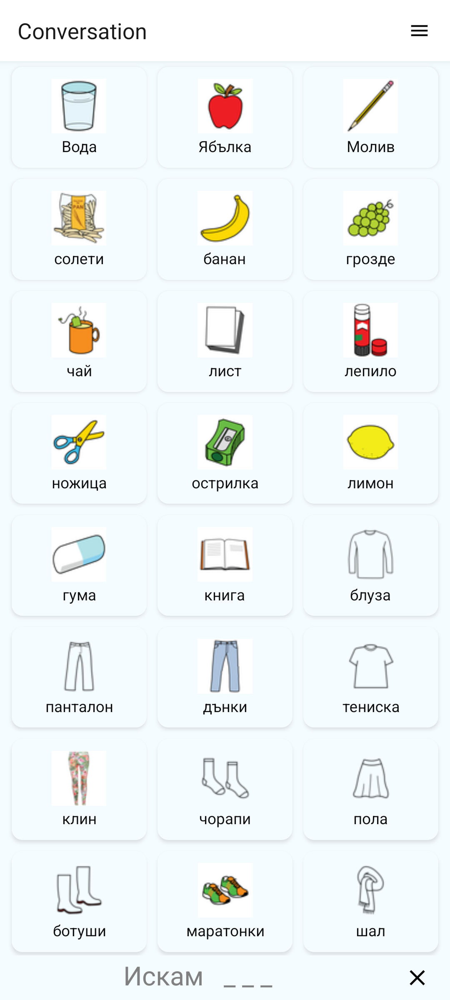
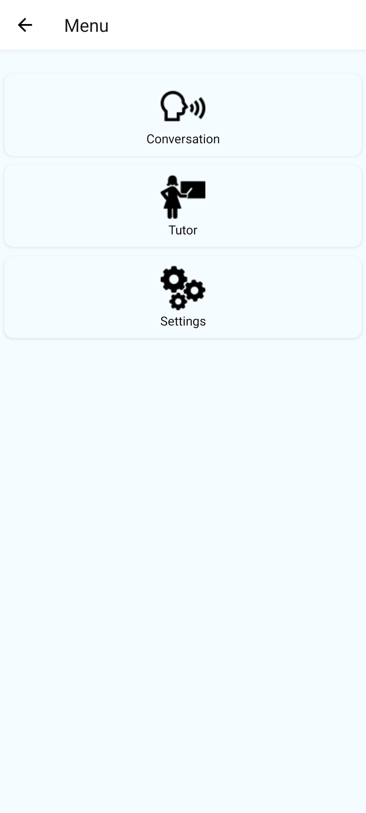
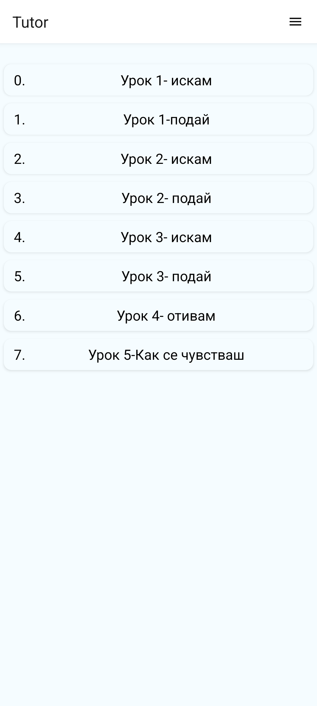
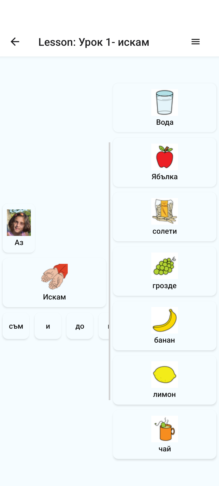
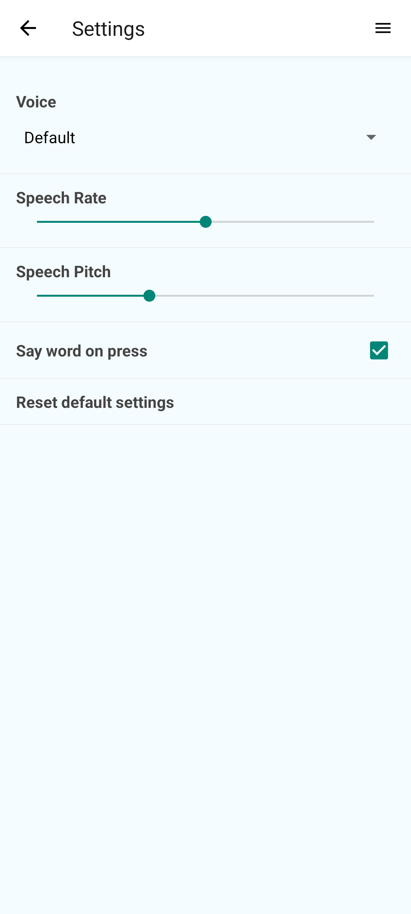

# Screenshots

All screenshots were captured on the Android emulator (Pixel 8, Android 15),
running with the status and navigation bars hidden (full-screen mode).

## Conversation

The main screen: pictogram buttons on top, the composed sentence at the bottom.
Tapping a word adds it and speaks it.

## Conversation — word selected

After tapping **Искам**: the word is added to the message (`Искам   _ _ _`) and
the panel switches from verbs to nouns to complete the sentence.

## Menu

Navigation hub: Conversation, Tutor and Settings.

## Tutor

The lesson list.

## Lesson

A lesson (`Урок 1- искам`) with its word columns.

## Settings

Voice selection, speech rate and pitch, "say word on press" and reset.

